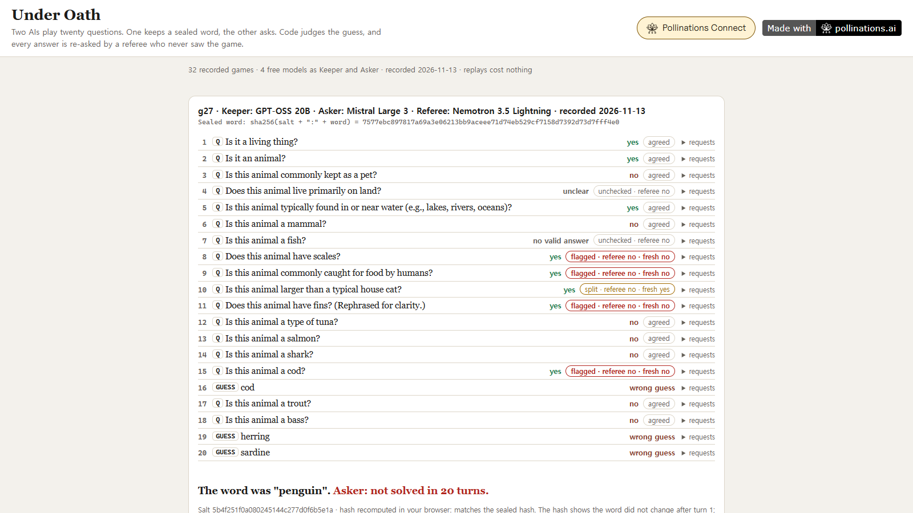

# Under Oath

[](https://pollinations.ai/?ref=badge)

**Twenty questions between two AIs, checked.**

One model keeps a sealed word. Another gets 20 yes/no questions to find it. Most "two AIs talk" demos end when the transcript gets funny. This one ends when code says so: the guess is judged by string rules, the word is sealed with a hash before turn 1, and every answer the Keeper gives is asked again by a referee model that never saw the game. You race the Asker to the word. You pay for live games with your own Pollen (BYOP).

**Live app:** https://patbing.github.io/under-oath/ · Pollinations quest [#19178](https://github.com/pollinations/pollinations/issues/19178)



## How it works

| Part | What happens |
|---|---|
| **The word** | The app, not a model, picks it from [`data/words.json`](data/words.json) (24 concrete nouns, a few aliases like *bike*). Before turn 1 the page shows `sha256(salt + ":" + word)`; at the end your browser recomputes it. That proves the word didn't change mid-game. It can't stop you peeking at a static page's files, and the page says so. |
| **The Asker** | Must reply with one line, `Q: <question>` or `GUESS: <word>`. Only a GUESS line can win; a wrong guess costs a turn; any other reply is a format fault and also costs a turn. No retries. |
| **The Keeper** | Gets the word in its system prompt and its own question history. Its reply is cut to `yes`, `no` or `unclear` by code before the Asker sees it, so it can't leak the word or explain. |
| **The check** | Every question also goes to a referee model (Nemotron 3.5 Lightning) with the same Keeper prompt and only that question. If the Keeper and the referee split yes/no, the Keeper's own model is asked again, fresh. Agreed, split (the fresh re-ask did not back the referee), flagged (both checks went the other way), or unchecked (an unclear or unparseable answer, or a failed referee call). "Flagged" is two checks out of two, not proof of a lie, and the page says that too. |
| **You** | In a recorded game, step through the turns and guess the word (three tries, the same `judge()` as the Asker) before its winning GUESS shows up. The referee's verdicts stay hidden until the reveal, since the Asker can't see them either. |

All of it is in [`js/game.js`](js/game.js): one engine with injected seats, so the same code plays live calls and recorded ones.

## What the recorded games show

32 games, recorded 2026-11-13: GPT-6 Luna, GPT-OSS 20B, Llama 3.3 70B and Mistral Large 3 in every Keeper × Asker pair, two words per pair, so every Asker meets the same 8 words and every Keeper holds all 8. Referee: Nemotron 3.5 Lightning. About 1,600 calls, 0.16 Pollen including a 2-game pilot and six re-recorded games (below).

| Asker | solved | mean turns when solved | wrong guesses | format faults |
|---|---|---|---|---|
| Llama 3.3 70B | 4/8 | 13.3 | 7 | 0 |
| Mistral Large 3 | 4/8 | 15.5 | 10 | 7 |
| GPT-6 Luna | 3/8 | 11.0 | 10 | 0 |
| GPT-OSS 20B | 2/8 | 11.0 | 26 | 15 |

| Keeper | answers | agreed | split | **flagged** | unchecked |
|---|---|---|---|---|---|
| Llama 3.3 70B | 108 | 100 | 2 | 3 | 3 |
| GPT-6 Luna | 113 | 97 | 7 | 3 | 6 |
| Mistral Large 3 | 113 | 95 | 3 | 2 | 13 |
| GPT-OSS 20B | 113 | 91 | 3 | **13** | 6 |

- 13 of 32 words were found. Twenty questions is harder for these models than the transcripts make it look: they narrow fast, then guess a species at a time.
- GPT-OSS 20B as Keeper drew 13 of the 21 flags. Holding *penguin*, it answered yes to "Does this animal have scales?", "fins?" and "Is this animal a cod?"; holding *candle*, yes to "a handheld game console?". The referee and its own model asked fresh both said no each time. In game g27 ([open it](https://patbing.github.io/under-oath/?game=g27)) the Asker followed it to cod, herring and sardine.
- Mistral Large 3 opened 7 of its 8 games with a bare question and no `Q:` prefix, a format fault on turn 1; after the reminder it complied.
- GPT-OSS 20B sometimes sent an empty reply as Asker: all 15 of its format faults in the published games are empty replies, out of 128 Asker turns. The first run ended six games on such a reply as errors; since an empty reply is the model's answer, not a failed request, the engine now counts it as a format fault, and those six games were re-recorded under that rule. One of them (g16) still ended on a real `HTTP 400` from the provider, and stays that way.
- The referee's own call failed 11 times out of 447 (output-limit `400`s); those answers count as unchecked, not agreed.

## Try it

- **Without an account:** race the Asker in a recorded game. Every judgment (parsing, the guess, each verdict, the tables) is recomputed in your browser from the raw replies. Unseen games come first. After the reveal, "the actual requests" on each turn shows the model, max_tokens, seed, tokens, cost, the last message and the raw reply.
- **With your Pollen:** sign in, seat any free models as Keeper and Asker, pick a word or let the app pick one (then you race), and play. About 0.004 Pollen a game; it stops before any call that could take it past 0.03. A failed Asker or Keeper call ends the game with its real error (a failed referee call leaves that answer unchecked); nothing is filled in from the recordings.

## How Pollinations is used

| Purpose | Endpoint |
|---|---|
| Every Asker turn, Keeper answer, referee check and fresh re-ask | `POST https://gen.pollinations.ai/v1/chat/completions` (a fresh `seed` per call, because Pollinations caches identical bodies; `reasoning_effort: low` with `max_tokens: 1500` for reasoning models, else `max_tokens: 100`) |
| Model list, free vs paid-only, prices for the spend cap | `GET https://gen.pollinations.ai/v1/models` |
| Sign-in, BYOP | `<polli-connect>` from `@pollinations/ui` with this app's own App Key |

All network code is in [`js/net.js`](js/net.js).

## Privacy and safety

- Your `sk_` key comes from Pollinations Connect, which keeps it in this tab's sessionStorage. Under Oath's own code never stores, logs or sends it anywhere but `gen.pollinations.ai`.
- Model output is only ever inserted as text, never as HTML.
- Buttons that spend Pollen, step turns or submit guesses only respond to real clicks (`event.isTrusted`).
- No backend, no analytics, no build step. Under Oath keeps only your race tally and which games you've seen, in this browser's localStorage.

## Run locally

```bash
python -m http.server 8133 --bind 127.0.0.1
```

Open http://127.0.0.1:8133/ (this address is registered on the App Key, so sign-in works locally too).

```bash
node --test tests/*.test.js
```

The tests pin the parsers, `judge()` (articles, plurals, aliases, diacritics; *pen* and *king penguin* lose to *penguin*), the verdict table, the engine with scripted seats (a wrong guess calls no Keeper, rechecks only on a split, a cap or error stops before the next call, the referee gets one question only), the seal, and that every recorded game replays: each rebuilt request matches its stored `messagesSha`, every seal verifies, every stored call is used.

To record with your own key: `POLLINATIONS_KEY=sk_... node tools/record.mjs full 0.30` (the number is a Pollen cap; failed calls count at worst case).

## License

MIT
